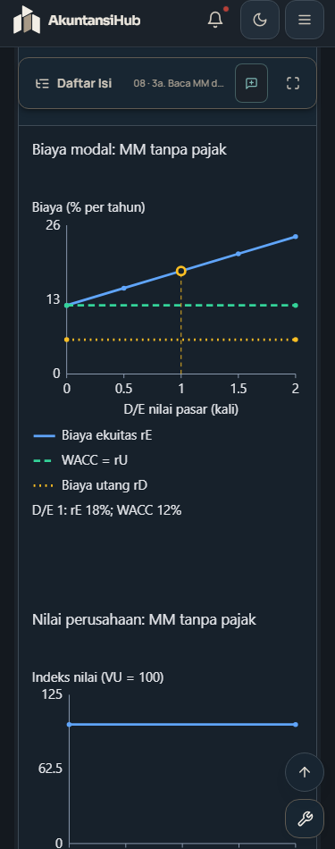

# Verifikasi revisi audit 12 Oktober 2026

Main sumber: e773066b9167f65c41cbdba2aae4bb5c1a36b7d1. Pengembangan semester 2 dihentikan sesuai arahan terbaru pengguna; revisi yang sudah selesai tetap disertakan. Manajemen Stratejik diperiksa baca saja. Kelulusan teknis tidak menjadi kesimpulan materi sudah lengkap.

## Hasil akhir

| Pemeriksaan | Hasil |
| --- | --- |
| Baseline standar sebelum revisi | 70/70 lulus |
| Lint kode dan sumber | Lulus, 380 berkas TypeScript/TSX |
| TypeScript dan build produksi | Lulus; peringatan ukuran chunk masih ada |
| Tes standar revisi | 76/76 lulus; empat pemeriksaan terarah SIA/snapshot/pra-UTS setelah penyempurnaan kalimat terakhir juga lulus |
| Runtime | Lulus pada build akhir: aset, rute, timer, fingerprint dataset dan penyimpanan sesi |
| E2E Chrome | Lulus: bank PTE, simulator 90 menit, pemulihan timer pajak, rute/404, sesi dan tema |
| Browser grafik/bacaan | 392 kombinasi final, tanpa label terpotong, overflow halaman, error KaTeX atau label grafik mobile di bawah batas |

Bukti final berada di evidence/test-results.json dan evidence/browser-results.json. Pemeriksaan 392 kombinasi dilengkapi pengulangan 28 kombinasi AKM301 setelah koreksi kanvas dan 28 kombinasi SIA setelah kalimat sumber diperjelas. Hasil ulang menggantikan baris mata kuliah tersebut. Foto yang disertakan adalah tangkapan aplikasi sendiri, tanpa halaman buku sumber.

Tangkapan pembanding: [ponsel terang](evidence/mm-375-light.png), [desktop terang](evidence/mm-1440-light.png), [desktop gelap](evidence/mm-1440-dark.png).

## Kebenaran isi diperiksa terpisah

- MNK102: rumus MM tanpa pajak dan pajak perusahaan, bobot pasar D/E, kurva rE/WACC/VL, jumlah probabilitas, angka Bigbee dan kas Allied dihitung ulang. Dataset ilustrasi diberi asumsi; angka historis tanpa tabel titik mentah tidak direka. Terdapat 31 figure pasca-UTS/review yang diperiksa, dengan empat visual tambahan dan perbaikan penyajian grafik.
- AKK202: Evermaster 92.278 EUR dan amortisasi, Roche liability 1.805.626/equity 194.374, Bao ECL 12.680 ribu yen, serta gain utang Bonn berbeda dari rugi aset, dicocokkan dengan halaman Kieso. Tiga grafik numerik menggunakan data contoh asli dan pembulatan yang dijelaskan.
- PJK301: grafik lapisan tarif memakai UU HPP sebagai dasar, dengan PKP dan pajak yang berbeda dari TER. Tahun kasus 2024/2025 dipertahankan.
- SII306: rujukan tujuh TM dibandingkan dengan Richardson asli; 14 butir diperbaiki, set UAS tetap 35. Snapshot bacaan dan kuis di 04 JSON diperiksa sama dengan implementasi. Definisi RPA vendor ditandai sebagai tambahan; klaim triple-entry dan perlakuan kripto mempunyai batas.
- Materi lainnya: 49 delta kanonik, enam grafik sumber/ilustrasi, hitungan rekonsiliasi, aging, NRV, biaya, EOQ dan NPV diperiksa. Sebanyak 168 kartu pada empat mata kuliah dipetakan ulang; pra-UTS dipertahankan.
- MNU307: angka enam studi kasus keuangan serta konflik H&M diperiksa langsung. Temuan tujuh kasus, kebutuhan grafik berskala dan ketiadaan set UAS terpisah ada di MNU307-priority-findings.md. Data dilindungi tidak diedit.

## Komponen dan batas pengujian

Tes komponen MNK102, AKK202 dan PJK301 membuka bacaan, rumus, contoh/pembahasan, bank kasus, kartu dan pilihan kuis yang diacak. Penilaian jawaban benar/salah diuji sesuai kunci. Target 60 kuis, 42 kartu pra-UAS dan 14 kasus tetap untuk ketiga paket tersebut. PBR dan SIA mempertahankan target historisnya sendiri.

Pemeriksaan browser melintasi tujuh TM pada 14 mata kuliah, lebar 375/1440 px dan tema terang/gelap. Detail dibuka, overflow halaman dan error KaTeX diperiksa. Label grafik tambahan diperiksa terhadap viewBox termasuk rotasi/transformasi; label mobile disyaratkan sekurangnya 12 px. Hasil mesin ini dilengkapi inspeksi tangkapan layar, dengan audit isi sumber tetap terpisah.

Kegagalan selama pengerjaan dicatat: guard release lama perlu mendukung v1.3.7 sambil mempertahankan sejarah; escape formula diperbaiki; alias kartu SIA dan identitas data AKM301 dipulihkan; harness komponen AKK202/PJK301 diperbaiki agar memakai React yang sama. Satu kegagalan simulator PTE sempat muncul dan lulus pada pengulangan, dengan penyebab awal belum dipastikan. Run paralel akhir gagal pada pemuatan CommonJS React dan berkas cookie Chrome terkunci; profil browser berikutnya ditempatkan di direktori sementara OS, cache Vite dibersihkan dan pemeriksaan dijalankan berurutan. Label BSC AKM301 TM8 memang melewati canvas setelah translasi kelompok, sehingga tingginya diperbaiki dan browser diulang. Warning nested paragraph masih muncul pada runtime dan tidak disembunyikan sebagai isi yang lengkap.

## Reproduksi dan perlindungan

Jalankan npm run lint, npm test, npm run build, npm run test:runtime, lalu npm run test:e2e secara berurutan. Untuk pemeriksaan 14 mata kuliah, set AUDIT_COURSES sesuai daftar di README dan jalankan node scripts/test-finance-browser.mjs. Port dapat diatur dengan E2E_PREVIEW_PORT dan E2E_CDP_PORT. Profil browser pengujian terpisah dari profil pengguna.

Data pra-UTS 17 mata kuliah dibandingkan dengan fixture main yang terkunci. Berkas src/data/manstrat, UpdateNotifier.tsx dan index.css dibandingkan dengan isi main, dengan normalisasi line ending Git agar guard berlaku pada Windows/Linux. Guard lama 121 berkas mempertahankan hash baseline; delapan perubahan yang diizinkan mempunyai daftar hash eksak tambahan. Paket revisi memakai atribut Git yang mempertahankan byte fingerprint.

Urutan regenerasi bila diperlukan: generator mata kuliah, generator flashcard, audit-sia-options, lalu sync-audit-deltas. audit-course-inventory diikuti audit-exercise-traceability memperbarui daftar celah dari konten terdaftar. Jangan menangkap ulang fixture pra-UTS dari hasil revisi.

Daftar kekurangan sumber dan latihan berada di README, laporan setiap kode, serta exercise-traceability.md. Pekerjaan yang belum terverifikasi tetap dilaporkan.
